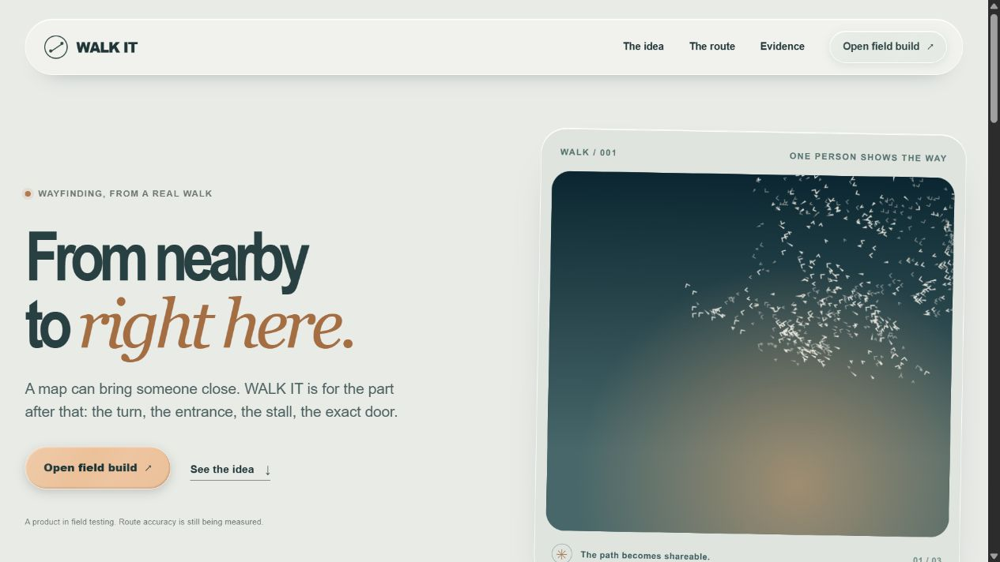
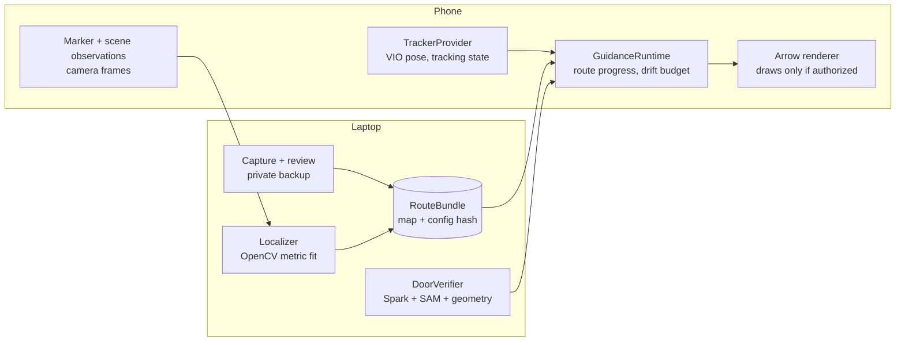
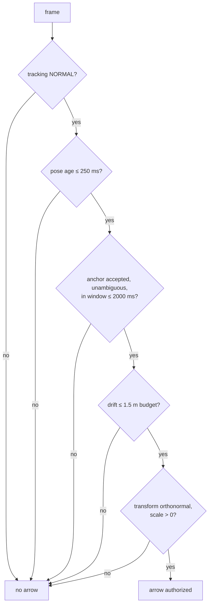
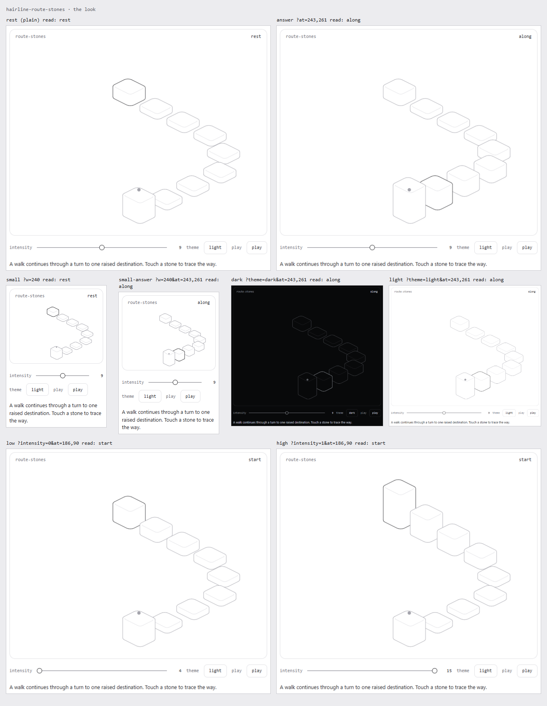

# WALK IT

> A map can bring someone close. WALK IT is for the part **after** that — the turn, the gate, the courtyard, the exact door. Someone who already knows the way walks it once and sends a link. The visitor follows arrows that are only drawn when the geometry is real, and is told out loud when the system is not sure.

**Meta Global AI Developer Hackathon · Build for Your World · Indie track.**

| | |
|---|---|
| **What ships today** | A camera capture path, a metric localizer, an AR guidance runtime with per-frame authorization gates, a fail-closed destination verifier, and a recorded-replay playground — all runnable from a clean clone in three commands. |
| **Meta models** | **Muse Spark** (`muse-spark-open-1026`, via Baseten) reads signage in the destination frame; **SAM 3.1** segments the door by concept. Both are called from the verifier and both have real, logged receipts. |
| **Evidence rule** | Every claim in this file is tagged **LIVE**, **RECORDED REPLAY**, **SYNTHETIC** or **NOT YET**. There is no fifth category. Nothing is implied. |
| **Config identity** | [`config/vision.yaml`](config/vision.yaml) — 103 thresholds, all units explicit. Raw SHA-256 **`2c9a4989cd11b899b75234a87cfd8957c971bbacdf340eed6e39d163a13f96d1`** as checked out here (CRLF); LF-normalised **`d7edef6dd5759455bc2c90d82dc874291b543e37f2f2acf90b127686f6cef68c`**; canonical-JSON SHA-256 (line-ending independent) **`178f9d44a051926d22b118bfeb3060ceb75a55a66861bd9001f465304627718f`**. See the note under §8. OpenCV pinned to **5.0.0.93**; a version mismatch is a refusal, not a warning. |
| **Tests** | geometry suite **152/152** · web suite **101/101** across 36 files · typecheck and production build clean — all re-run on 3 November against this checkout. |
| **Field truth** | Fresh-session visitor arrivals: **0**. Measured route-end errors: **0**. Committed photographs: **0** — 5,009 entries under `eval/sessions/` are deliberately gitignored. The headline demo has not passed yet, and this README says so in every place it matters. |


*Design render of the product surface. The line under the fold — "A product in field testing. Route accuracy is still being measured." — is the honest state of this build, and it is in the UI, not just here.*

---

## 1. The problem is not navigation. It is the last 30 metres.

Every routing product on earth ends at a **pin**. A pin is a coordinate with a 15-metre shrug attached to it. It says *somewhere around here*. Then it stops talking, and the human does the hard part: which gate, which stairwell, which of the four identical doors, which side of the building the pickup point is actually on.

This is not a small gap that only bothers tourists.

- In a hostel with 400 beds and one courtyard with three entrances, "nearby" is useless.
- In a school, a parent at the wrong gate loses instructional time.
- In an office tower, the visitor desk is in the wrong lobby and someone walks down to collect a stranger.
- In a storied or heritage building, the accessible entrance is not the impressive one, and no map knows the difference.
- In a delivery, the parcel is marked delivered at the wrong door and the exception gets handled by a human on a phone.

The last-mile economics are published, if bluntly: industry operations write-ups put last-mile at roughly **53% of shipping cost** at around **$18 per parcel** ([SmartRoutes](https://smartroutes.io/blogs/last-mile-delivery-statistics/), [GoBolt](https://www.gobolt.com/last-mile-delivery-statistics/)) — vendor-published figures, cited as *their* numbers, not independently audited here. The public-sector version of the same problem is street addressing, which the [World Bank](https://www.worldbank.org/en/topic/urbandevelopment/public-brief/street-addressing) treats as infrastructure, because without it, emergency response, postal delivery and tax administration all degrade together.

We are not going to solve all of that from a hackathon. What we built is the part nobody else seems willing to build carefully: **a system that knows when it does not know.**

## 2. The thesis

Intelligence is cheap now. A model that can read a sign, segment a door, and describe a facade costs cents and answers in seconds. **Verification is the scarce ingredient.**

So WALK IT does not use models to *find* the destination. It uses models to *corroborate* a destination that geometry already proposes — and it requires the two to agree before it will draw an arrow toward anything. Where they disagree, or where either is unsure, the arrow disappears and the app asks for a rescan.

That single inversion — *geometry proposes, models corroborate, uncertainty cancels* — is the whole product idea. Everything below is what that costs to build honestly.

## 3. How to read this repository

Four evidence classes, used consistently in the README, in [`docs/BUILD_LEDGER.md`](docs/BUILD_LEDGER.md), and in the UI itself.

| Tag | Meaning | Example |
|---|---|---|
| **LIVE** | Runs on a real phone with a real camera, right now. | Tracking status, sway protocol, per-frame arrow gate. |
| **RECORDED REPLAY** | Real frames, captured earlier, replayed offline through the same code. | The 10-frame localizer audit in §8. |
| **SYNTHETIC** | Contract fixtures that prove code paths and refusals. Not field evidence. | Marker, drift and verifier fixtures. |
| **NOT YET** | Not measured. No number is invented for it. | Fresh-session visitor arrival accuracy. |

A judge who wants to catch us exaggerating will find nothing to catch, because the exaggeration is structurally impossible in the way the repo is written: the UI refuses to render an arrow without a fresh geometric fit, and the README refuses to print a number without a command that reproduces it.

## 4. What this build does today — and what it does not

| Capability | Class | Evidence you can check |
|---|---|---|
| Camera permission, tracking state, privacy review gate on a real phone | **LIVE** | [`docs/TESTING.md`](docs/TESTING.md), [`docs/E03_FIRST_PHONE_RESULT.md`](docs/E03_FIRST_PHONE_RESULT.md) |
| One-walk host capture → reviewed keyframes → private JSON backup | **LIVE** | [`docs/HOST_CAPTURE.md`](docs/HOST_CAPTURE.md), [`docs/ONE_WALK_CAPTURE.md`](docs/ONE_WALK_CAPTURE.md) |
| Printed DICT_4X4_50 marker detected, pose estimated, metric scale recovered | **LIVE code** | [`geometry/marker_scale.py`](geometry/marker_scale.py), [`design/start-marker-a4.svg`](design/start-marker-a4.svg) |
| Folded two-panel target solved jointly with SQPNP; a flat pair refused as coplanar | **SYNTHETIC** | [`geometry/marker_anchor.py`](geometry/marker_anchor.py), [`geometry/test_folded_target.py`](geometry/test_folded_target.py), §10 |
| Folded target walked on real paper | **NOT YET** | §10 — printed, taped and folded sheets have not been captured |
| Trailing-window preflight that unlocks *Record author walk* only on a passed 4-view fit inside 2000 ms | **LIVE code** | [`apps/web/src/live.ts`](apps/web/src/live.ts) |
| Route-bound live fit installed into the guidance runtime (visitor path) | **LIVE code** | [`apps/web/src/live-anchor-certificate.ts`](apps/web/src/live-anchor-certificate.ts) |
| World-locked arrow, position-only, same camera session, visibly labelled as such | **LIVE code** | banner: *"Same-session live replay, not fresh-start navigation"* |
| Reference-image localizer with ambiguity refusal | **RECORDED REPLAY** | [`scripts/replay-repro.ps1`](scripts/replay-repro.ps1), [`docs/LOCALIZER_GATE.md`](docs/LOCALIZER_GATE.md) |
| Muse Spark signage read + SAM 3.1 door segmentation, with provider receipts | **RECORDED REPLAY** | [`docs/META_USAGE.md`](docs/META_USAGE.md), §6 below |
| Fail-closed destination verifier (≥2 distinct frames, decoy exclusion) | **SYNTHETIC** | [`geometry/`](geometry) verifier contract tests |
| Drift budget, pose-age gate, anti-forgery arrow authorization token | **SYNTHETIC** | [`apps/web/src/route-arrow.ts`](apps/web/src/route-arrow.ts) |
| **A visitor opening a link in a fresh session and being guided to the exact door** | **NOT YET** | 0 verified starts, 0 confirmed arrivals, 0 measured end errors |

That last row is the reason this README is written the way it is. We are not hiding it. We are showing you exactly which gate is still shut, what it took to find it, and what measurement will open it.

## 5. Architecture

Four boundaries, kept deliberately boring. No accounts, no dashboards, no extra product features.



| Boundary | Owns | Must never own |
|---|---|---|
| **TrackerProvider** | Device pose and tracking quality. | Any claim about the world. |
| **Localizer** | Metric anchor: scale, rotation, translation from marker or reference views. | Whether the user should be told to move. |
| **RouteBundle** | The recorded path, destination identity, config hash binding. | Live camera state. |
| **DoorVerifier** | Corroboration of the destination across ≥2 frames. | Permission to draw an arrow alone. |
| **GuidanceRuntime** | The single yes/no: is an arrow authorized *this frame*? | Model inference. |

The arrow is not a UI element that gets hidden when something looks wrong. It is a **capability that must be re-earned every frame**:



The authorization token is a module-private `Symbol` in `route-arrow.ts`. A caller cannot construct a valid one from outside; it can only be produced by passing the gates. This exists because the easy way to fake an AR demo is to make the arrow a decoration. We made that impossible in the type system rather than in the release notes.

## 6. The Meta models — and the receipts, including the ugly ones

| Model | Endpoint | Role | Why this one |
|---|---|---|---|
| **Muse Spark** `muse-spark-open-1026` | `https://inference.baseten.co/v1/chat/completions` | Read signage/labels in the destination frame; confirm the visible name matches the route's destination. | Open weights, served by an official Meta inference partner, multimodal, and cheap enough to call per capture rather than per frame. |
| **SAM 3.1** | `https://api.meta.ai/v1/responses` | Segment "the door" by text concept, so geometry can ask whether the projected destination lands inside a real door and not a window or a poster. | Concept-prompted segmentation is the only practical way to bind a 3D point to a semantic object without training a bespoke detector in four days. |

Real logged calls, from [`docs/META_USAGE.md`](docs/META_USAGE.md) — not a demo-day mock:

```text
muse-spark-open-1026   24.875 s   1204 prompt / 416 completion / 1620 total tokens
                      visible_text: ["D10", "D9"]
                      usable_as_destination_evidence: false        ← it read the wrong door

sam-3.1               26.531 s   concept: "wooden door"
                      2 boxes returned                             ← verifier demands exactly 1
```

Both of those are refusals. We are showing them because they are the most informative results in the repository: the model worked, the *verifier* correctly declined, and the app did not claim an arrival. A demo that only shows green checkmarks tells you nothing about whether the system can say no.

Design rule, from [`config/vision.yaml`](config/vision.yaml): `VERIFY_MIN_DISTINCT_OBSERVATIONS_COUNT: 2`. A single mask is never a destination. Confirmation requires the same answer from two different frames plus projected geometry plus a required cue, with decoys explicitly excluded.

## 7. Rules we shipped as code, not as intentions

1. **Uncertainty hides the arrow.** Loss of tracking, route ambiguity or drift overrun cancels guidance immediately. Silence is a valid output.
2. **A segmented object is not a verified destination.** Semantics corroborate geometry; they never replace it.
3. **No silent version drift.** OpenCV 5.0.0.93 is pinned; a mismatch refuses the run rather than degrading quietly.
4. **Every threshold lives in config.** 103 keys with units, hash-checked, and the hash travels with the evidence so a result cannot be reinterpreted under different numbers.
5. **Private imagery never enters Git.** 5,009 entries of real capture data are ignored on purpose; the review step masks faces and plates before anything is saved, and the backup is a local file.
6. **A certificate is not a measurement.** The live arrow proves geometry the phone itself established. `fieldGatePassed` flips **only** when a separate record exists with a measured end error inside the 3 m budget and an evidence SHA-256 — see [`scripts/record-field-gate.py`](scripts/record-field-gate.py), which refuses to invent the number for you.

Rule 6 is the one that decided the shape of this project. It would have been trivial to ship an arrow and caption it "AR navigation." We split the claim instead, so the app can honestly say *the geometry is verified* while separately admitting *the cross-session accuracy is unmeasured*.

## 8. Numbers that are actually measured

| Metric | Value | Class | Reproduce |
|---|---:|---|---|
| Commits, 27 Oct → 3 Nov 2026 | 43 | **LIVE** | `git rev-list --count HEAD` |
| Geometry unit tests | 152 / 152 | **LIVE** | `.venv\Scripts\python.exe -m unittest discover -s geometry -p 'test_*.py'` |
| Web unit tests | 101 / 101 (36 files) | **LIVE** | `npx vitest run --configLoader native` |
| Typecheck and production build | clean | **LIVE** | `npm run typecheck && npm run build` |
| Config keys with explicit units | 103 | **LIVE** | `grep -c ':' config/vision.yaml` |
| Archived config revisions | 11 | **LIVE** | `ls config/archive/*.yaml \| wc -l` |
| Logged real-data runs in the ledger | 27 | **RECORDED REPLAY** | [`docs/BUILD_LEDGER.md`](docs/BUILD_LEDGER.md) |
| Private capture artifacts held out of Git | 5,009 entries | **LIVE** | `ls eval/sessions \| wc -l` |
| Localizer attempts on first 10 visitor-scan frames | 10 | **RECORDED REPLAY** | `powershell -ExecutionPolicy Bypass -File .\scripts\replay-repro.ps1` |
| Frames with ≥1 accepted candidate | 4 (all ambiguous) | **RECORDED REPLAY** | same command |
| Frames with no accepted candidate | 6 | **RECORDED REPLAY** | same command |
| Verified fresh-session visitor starts | **0** | **NOT YET** | — |
| Confirmed destination arrivals | **0** | **NOT YET** | — |
| Measured route-end errors | **0** | **NOT YET** | [`scripts/record-field-gate.py`](scripts/record-field-gate.py) |
| Marker orientation disagreement, first 9 frames of the saved walk | 36.8° vs a 10° limit | **RECORDED REPLAY** | §9 |
| …same window after dropping the first 4 frames | **3.8°** | **RECORDED REPLAY** | §9 |
| …and the baseline that still refuses it | 0.31 m vs a 0.4 m minimum | **RECORDED REPLAY** | §9 |
| End-to-end Meta model latency | 24.9 s and 26.5 s | **RECORDED REPLAY** | §6 |
| Photo-real imagery committed to the repo | **0** (7 tracked files: 4 marker SVGs + 3 design renders, no photographs) | **LIVE** | `git ls-files \| grep -E '\.(jpg\|jpeg\|png\|svg)$'` |
| Folded target calibrating through the untouched gate, 4 human-like walks × 3 seeds | **11 / 12** | **SYNTHETIC** | §10 |
| Same walks, same gate, today's single square | **0 / 12** | **SYNTHETIC** | §10 |
| Real capture frames where the folded path changed today's result | **0 of 57** | **RECORDED REPLAY** | §10 |
| Spurious companion-panel detections in the real 57-frame capture | **0** | **RECORDED REPLAY** | §10 |

**A note on the config hash, because it is a reproducibility hazard and not a tidiness issue.** This repository has `core.autocrlf=true` and no `.gitattributes`, so `config/vision.yaml` is stored with LF and checked out with CRLF. Both `geometry/marker_scan.py` and `apps/web/src/settings.ts` hash the bytes they are actually given, so the *raw* SHA-256 differs between a Windows checkout and a Linux one, and a route issued on one would be refused by the other with `Current configuration and image review required`. The **canonical-JSON** hash above is computed from parsed keys and is therefore line-ending independent — that is the one to compare across machines, and it is what `marker_scale.py` and `visitor_marker_alignment.py` already embed in their receipts. Adding `.gitattributes` would fix the raw hash too, but it rewrites every text file's checkout and was deliberately **not** done hours before a field session; it is recorded in [`docs/DECISIONS.md`](docs/DECISIONS.md) as an open item rather than silently patched.

## 9. The finding we paid for: the tracker needs four seconds

The failure that ate the most days was a marker fit that disagreed with itself by 37° on frames the phone had happily recorded. It looked like a broken localizer. It was not.

We isolated it offline, on a real saved walk, 57 frames, same OpenCV build, same code path.

| Frame | kf0 | kf1 | kf2 | kf3 | kf4 | kf5 | kf6 | kf7 | kf8 |
|---|---|---|---|---|---|---|---|---|---|
| Marker orientation error | 0° | 9° | 24° | 30° | 35° | 49° | 47° | 53° | **54°** |

The error *ramps and then plateaus*. That shape is the signature of a coordinate frame still converging — ARKit's world-frame yaw and gravity estimate settling during the sway window — not of a marker, a camera or a math bug. Dropping the earliest frames collapses it: **36.8° → 18.1° (drop 1) → 3.8° (drop 4)**, and the last four frames agree within 1.1°.

Six alternative hypotheses were tested and ruled out with data, not opinion:

| Hypothesis | Test | Result |
|---|---|---|
| Marker printed at the wrong size | Sweep edge length 0.10–0.22 m | No change to disagreement. Physical measurement: 16.0 cm = config. |
| IPPE planar ambiguity flip | Inspect the second solution on accepted frames | ≥12× worse RMS; the 1.5 gate already refused the one real case. |
| GL ↔ CV conversion convention | Re-derive both | Consistent; not the cause. |
| Keyframe ↔ pose pairing error | Re-pair independently | 0.000 m, 0.01° difference. |
| Timing lag between pose and image | Scan offsets | Minimum at 0 ms. |
| Tracker jumps / dropouts | Step-length audit | Max step 0.034 m. Clean. |

**The permanent fix is a product change, not a patch.** Recording is gated on a *time* window, not a frame count — and the two time limits are now separate, because they answer different questions. `MARKER_CALIBRATION_EVIDENCE_MAX_AGE_MS: 6000` is how long the preflight is allowed to **accumulate** views; `ALIGNMENT_WINDOW_MAX_AGE_MS: 2000` is how fresh a **pass** must be to unlock *Record author walk*, unchanged. The split is measured, not chosen: across the marker-visible stretch of the saved evidence4 walk, **no** 2 s window reached the 0.4 m baseline and the widest was 0.272 m — 0.136 m/s, so 0.4 m needs at least 2.94 s of accumulation. Elsewhere in the same recording 1,054 two-second windows exceed 0.4 m (widest 0.745 m). The same person moves fine; they slow to roughly a third of that speed while aiming at a sheet of paper. Every geometric limit stays **unchanged** — 10° orientation spread, 5% pairwise scale disagreement, 0.4 m metric baseline, ≤2 m marker distance, ≥4 views — and a pass is still anchored to the newest view, so the 2000 ms action freshness is intact.

Inside that window the preflight no longer lets a bad start veto a good finish. `geometry/calibration_window.py` searches suffix windows — candidates always keep the newest view and may only drop *leading* views — and offers the best-conditioned one to the untouched gate, scoring by the largest minimum margin over baseline, orientation spread, pairwise scale and residual. Unsettled frames at the start of a session are set aside rather than allowed to refuse the walk that followed them. On a refusal the miner still reports the near-miss, and the phone now prints every measured gate against its own configured budget plus which gate is tightest (`span 0.48 m of 0.40 m · spread 12.5° of 10.0° ✗ · 5 of 8 views kept · tightest gate spread 1.25× over budget`), so a refusal tells the user what to change instead of just saying no.

The saved evidence4 walk still refuses today: its last settled four-view window reached **3.8° spread** but only **0.31 m span** against the 0.4 m minimum. We kept the threshold and kept the refusal. That is the most useful line in this README — and it is why §10 changes the paper instead of the numbers.

## 10. The loophole we found: the target's shape, not a threshold

Every geometric limit in §9 stayed exactly where it was, and the saved walk still refused. So we stopped tuning the estimator and asked why a **plane** was being trusted to supply three things at once: orientation, metric scale and a unique pose. It cannot. IPPE hands back two solutions for a plane; the 1.5 second-error ratio refuses the bad ones; what is left is a depth along the camera axis that no amount of corner refinement can pin down.

The literature says the cure is geometry. OpenCV issue #8813: *"If you have one or more additional markers that are not co-planar to the original marker, then you can resolve the ambiguity."* So the target is now **two A4 sheets taped at their white borders and folded to 90°** — a partly open book standing on a table — and both squares are solved **jointly** with `SOLVEPNP_SQPNP`, which is globally optimal for non-coplanar points and returns a single solution. The two-solution ratio test is not weakened by this; it is structurally inapplicable, and in exchange the path demands strictly more: two configured panels, both detected, and provable non-coplanarity (`MARKER_MIN_NONCOPLANARITY_RANK_RATIO`).

Two decisions keep this honest:

- **The target frame is panel zero's own frame.** `cameraCenterMarkerM` keeps its exact previous meaning, so every existing route, receipt and downstream consumer is untouched. Panel zero is byte-identical to the old single square — asserted, not assumed.
- **A flat pair is refused, never jointly solved.** Two markers on one sheet are still coplanar and still ambiguous. `coplanar-target-ambiguous` is a real refusal with a test, so the fold cannot be faked by printing two squares side by side.

Measured on rendered pixels at the real evidence4 scale (1.2464 tracker units per metre), judged against **ground-truth** session poses — deriving the tracker pose from the solver's own guess would make the orientation gate tautological, and that mistake was caught and fixed:

| Target, at its own instructed stance | Calibrates | Accepted poses (of 25) | Orientation spread, median / max | Pairwise-scale refusals |
|---|---:|---:|---|---:|
| Folded pair, facing the crease (45°) | **11 / 12** | 25 | **0.45° / 0.80°** | 1 |
| Single square, square-on (today) | **0 / 12** | 11–23 | 3.49° / 4.24° | 12 |
| Folded pair, laid **flat** | **0 / 12** | — | — | refused `coplanar-target-ambiguous` |

The single square is not refused for want of frames — it supplies plenty. It is refused because the pairwise scale it implies disagrees by more than the 5% the gate allows. That is the planar-depth defect, and the fold removes it: spread falls roughly tenfold and every gate is met with margin.

**The stance is a real cost, and it is stated rather than hidden.** A 90° fold shows one panel exactly edge-on from straight ahead, so both squares are only visible from the crease's bisector. Sweeping fold angle against stance measured that square-on never works for *any* fold — 75° and 90° give 0/12, 120° gives 0/12 and 60° only 6/12 — while 90° at 45° gives 11/12 with the best non-coplanarity of the practical set (0.606). So the phone now says *"Stand at the fold, not square-on to it: face the crease so BOTH sheets show at once"*, before any refusal, and repeats it with the live panel count whenever fewer panels than configured are in frame. Practical distance band is **0.7–1.0 m**; beyond that `MARKER_POSE_MIN_EDGE_PX` refuses for `marker-too-small`, unchanged.

**No regression on real data.** Across all 57 frames of the saved evidence4 capture the companion panel is spuriously detected **0** times and `estimate_start_marker_pose` diverges from today's single-square path on **0** frames. The folded path is inert unless the second sheet is physically there.

**What this is not.** It is **SYNTHETIC** evidence: rendered markers, simulated trajectories, a known similarity. No folded target has been printed, taped, folded and walked yet. The claim is *the gate that refused every real attempt now passes on rendered walks that behave like a person, with no threshold moved* — and the honest next step is one recording session against paper.

## 11. Two paths, and exactly what each one proves

**Path A — fresh-session navigation (the real product).**
Author preflight locks → one-walk capture → private backup → [`scripts/marker-preflight.ps1`](scripts/marker-preflight.ps1) accepts → [`scripts/issue-route.ts`](scripts/issue-route.ts) issues a route link → visitor scans the same physical marker in a **new** session → route-bound fit is installed in the guidance runtime → arrow appears → the walker's actual end error is measured with a tape and recorded with `scripts/record-field-gate.py`.
*Proves:* cross-session metric anchoring, and — once a measured record exists — navigation accuracy inside the 3 m budget.

**Path B — same-session live replay (the honest fallback).**
*Record position-only trail* → walk once → *Finish trail* → return to the same start → *Replay in this session*. A blue arrow renders in the live 3D canvas under the banner **"Same-session live replay, not fresh-start navigation."**
*Proves:* the world-lock, the gate cascade and the render path are real and running on a phone.
*Proves nothing about:* cross-session localization. It records no images, issues no route certificate, no visitor link, and measures no accuracy. The banner says so on screen, because a fallback that looks like the feature is the thing we most refuse to ship.

## 12. Privacy and security, as implemented

| Control | Implementation |
|---|---|
| Permission before capture | Camera consent gate; recording disabled until tracking is `NORMAL` and the privacy box is checked. |
| No unreviewed image leaves the phone | Every keyframe is reviewed on-device; drag rectangles mask faces, plates and private details before export. Unreviewed frames are discarded. |
| Nothing private in Git | 5,009 entries under `eval/sessions/` are ignored; the repo contains zero photographs. Backups download to the author's own machine. |
| Link protection | Route links carry expiring tokens; the phone server requires an access header, rejects cross-origin posts, caps body size, and keeps images in memory only. |
| No logging of imagery | Marker inference is one process per explicit scan; bytes are never written to disk or logs. |
| Never while driving | The UI states camera navigation is for stationary or walking use only. |
| No secrets committed | Keys, tunnel hosts and `tmp/phone-access.json` stay local; nothing in this repo authenticates a caller-supplied model receipt. |

## 13. Run it

```bash
npm ci
npm run build
node server/phone-server.ts
# second terminal
powershell -ExecutionPolicy Bypass -File .\scripts\start-live-phone-test.ps1
```

Python geometry needs OpenCV **5.0.0.93** exactly:

```bash
python -m venv .venv
.venv\Scripts\python.exe -m pip install opencv-python-headless==5.0.0.93 numpy
.venv\Scripts\python.exe -m unittest discover -s geometry -p 'test_*.py'
powershell -ExecutionPolicy Bypass -File .\scripts\check.ps1
```

Field protocol, in order:

1. Print [`design/start-marker-a4.svg`](design/start-marker-a4.svg) **and** [`design/start-marker-a4-panel2.svg`](design/start-marker-a4-panel2.svg) at actual size, and measure the 100 mm check bar on each. A4, DICT_4X4_50 IDs 0 and 1, 0.16 m black squares.
2. Tape sheet 2's **left** white border to sheet 1's **right** white border and fold it backwards to **90°**, so the pair stands like a partly open book. Never cut the 25 mm white border — measured: panels touching at the fold are not detected at all.
3. Confirm the config SHA-256 matches the header. Capture, preflight, route issue and visitor fit must share one config. A config change invalidates every previously issued route link by design.
4. On the author phone: wait for `NORMAL`, check the privacy box, start marker preflight, then **face the crease** from 0.7–1.0 m so both squares are in frame, and take real sideways steps of about half a metre for 6–10 s. The status line reports the live panel count; if one sheet is missing, turn toward the crease rather than moving closer.
5. *Record author walk* unlocks only while a four-view fit has passed inside the trailing 2000 ms.
6. Keep the marker visible in the first ten recorded frames, walk once, mark the destination, review every frame, save the private backup.
7. `powershell -ExecutionPolicy Bypass -File .\scripts\marker-preflight.ps1 -CapturePath "<absolute backup path>"` → only an accepted report may be issued: `node scripts/issue-route.ts eval/sessions/tomorrow-marker-preflight.json`.
8. Give that link to the visitor, who scans the same physical folded target in a fresh session, standing at the crease.
9. Measure the real end error and record it: `python scripts/record-field-gate.py --route-id <id> --source-capture-sha256 <sha> --evidence <private-field-log> --end-error-m <measured-m> --output eval/sessions/<new-record>.json`. It refuses anything above 3 m and will not fabricate the measurement.

**Reproducibility, stated honestly:** `replay-repro.ps1` requires ignored private captures already on this laptop, so it is a local reproducibility result, **not yet a clean-clone judge command**. The replay and evidence pages publish no imagery; opened without a local capture they show an empty state, by design. `npm ci && npm run build && npm test` is clean-clone safe.

## 14. Where this is usable now, and what it becomes

The pattern — *a route is a physical measurement, an arrow is a privilege, and uncertainty is an output* — already fits places that no map pin serves:

- **Schools** — one capture per term; every parent at the right gate, no stranger at the reception desk.
- **Hostels and student housing** — 400 beds, three entrances, one correct stairwell.
- **Office towers** — the visitor badge path from the right lobby, captured once by the person who already knows it.
- **Hospitals and clinics** — where "the main entrance" is the wrong entrance for half the appointments.
- **Storied and heritage buildings** — accessible, conservation and staff entrances are three different doors, and signage cannot express that.
- **Delivery and pickup** — the exact bay, gate or desk, confirmed against a visible label rather than a coordinate.
- **Accessibility routing** — a step-free path is a *route property*, not a map property; it has to be walked by someone to exist.


*The guidance grammar we are building toward: a walk expressed as stones — one raised destination, touchable, readable at low intensity, and legible when the geometry is uncertain.*

The full product is a **verification layer for physical directions**. Route bundles become shareable, revocable data objects. The localizer stops needing a printed marker and settles on ordinary architecture. The verifier stops abstaining because the models get faster and the geometry gets better, not because the thresholds move. The trust primitive — *an instruction you can check, and a refusal you can see* — generalizes to anywhere a machine tells a human where to go.

That is also the investor argument, stated as claims we would accept in diligence:

- **Category**: not another map. Maps have 20 years of incumbency and no interest in the last 30 metres. This is a verification layer *on top of* them, and it composes with whichever one you already use.
- **Moat**: the hard asset is not the model — models are rented and getting cheaper. It is the **corpus of verified, human-reviewed physical routes** plus the refusal telemetry that says which ones degrade. Nobody collects that by shipping a confident arrow.
- **Unit economics**: one capture per route per term, minutes of human time, near-zero marginal cost per visitor. Model calls are per capture, not per frame, at the ~25 s / low-token cost measured in §6.
- **Regulatory posture**: privacy-by-construction (on-device review, no image retention, expiring links) is cheaper than retrofitting it, and here it is the architecture rather than a policy document.
- **What we will not claim**: no TAM slide built on "everyone gets lost." We have 0 verified fresh-session arrivals. The number that opens the market is a measured end error inside 3 m on a real street, and we built the instrument to record it before we built the marketing.

## 15. What the constraint cost

Five days, one short route, a real phone, a printed marker, and no willingness to fake the result. What that actually bought:

| Blocker | Measured cost | Status |
|---|---|---|
| VIO world frame converges slowly | 36.8° orientation disagreement in early frames | Solved as a product gate (6000 ms accumulation, suffix-window search, 2000 ms action freshness), not a threshold cut |
| Marker inference latency | 332 ms per cold-spawned Python frame — about one receipt a second, so a 2 s window held ~3 views and alignment was never even attempted | Solved with a warm persistent worker: 16.7 ms median, 20× faster, 4/4 byte-identical results |
| Single-marker PnP conditioning | At a 45–72 px marker edge (1.1–1.6 m from an A4 sheet) position error is 2.4–8.7 cm; corner refinement cuts reprojection RMS 0.315→0.176 px but position error only 3.83→3.81 cm | Solved by changing the target, not the estimator: a folded pair measured 0.22–1.00 cm over 0.70–1.60 m (§10). The residual error was conditioning all along |
| Planar marker ambiguity | Second IPPE solution ≥12× worse RMS; on rendered human-like walks the single square calibrates **0/12**, refused as `inconsistent-scale` every time despite supplying 11–23 accepted poses | Solved by non-coplanarity: SQPNP over a folded pair returns one globally optimal pose and calibrates **11/12** through the identical gate (§10) |
| The fold needs a stance | Square-on to the crease, one panel is exactly edge-on and the solve silently degrades to today's ambiguous square — measured 0/12 at 75° and 90°, 6/12 at 60° | Open, and coached rather than hidden: the phone states the stance before any refusal and repeats it with the live panel count. 90° at the bisector is the best practical pair measured (11/12, non-coplanarity 0.606) |
| Folded target on real paper | Not yet printed, taped, folded or walked | **NOT YET** — all §10 evidence is **SYNTHETIC**. One recording session is the next step |
| Reference-view localization on ordinary architecture | 4/10 frames with candidates, all ambiguous | Open; needs a wider, better-spread capture |
| Model latency | 24.9 s Spark, 26.5 s SAM | Open; forces per-capture rather than per-frame use |
| Cross-session accuracy | 0 measurements | Open; the instrument exists, the walk does not yet |

The last-mile and street-addressing figures in §1 are cited from their publishers, labelled as such, and are context rather than proof of our own impact. We would rather print one measured metre than ten borrowed percentages.

## 16. Provenance

Authored during the event window in this checkout, 27 Oct → 3 Nov 2026, 43 commits, one human author with an AI pair on engineering and documentation. No code was copied from another workspace. Dependencies are pinned; OpenCV is version-gated rather than trusted. Model weights and SDK binaries are not committed. Asset and third-party licences are recorded separately in [`docs/ASSETS.md`](docs/ASSETS.md) and [`docs/RULES_AND_RESOURCES.md`](docs/RULES_AND_RESOURCES.md). Decisions and their reasoning are in [`docs/DECISIONS.md`](docs/DECISIONS.md); the day-by-day record is [`docs/BUILD_LEDGER.md`](docs/BUILD_LEDGER.md). Dates and results in this file are real, including the ones that are inconvenient.

**Demo film (≤3:00):** submitted with the hackathon form; linked here once published.

## 17. Verifiable claims index

| If you want to check | Go here | Command or file |
|---|---|---|
| Tests actually pass | §8 | `npx vitest run --configLoader native`, `unittest discover -s geometry -p 'test_*.py'` |
| Thresholds were not softened | header | `sha256sum config/vision.yaml` = `f3474181…`; the 6000 ms key only lengthens how long views accumulate, and every geometric limit is unchanged |
| The arrow cannot be forged | §5 | [`apps/web/src/route-arrow.ts`](apps/web/src/route-arrow.ts) |
| The certificate is not hardcoded | §7 rule 6 | [`apps/web/src/live-anchor-certificate.ts`](apps/web/src/live-anchor-certificate.ts) |
| Model calls are real | §6 | [`docs/META_USAGE.md`](docs/META_USAGE.md) |
| The convergence finding is reproducible | §9 | [`docs/MOTION_EVIDENCE.md`](docs/MOTION_EVIDENCE.md), [`docs/SCALE_AUDIT.md`](docs/SCALE_AUDIT.md) |
| No private imagery leaked | §12 | `git ls-files`, `git check-ignore -v eval/sessions` |
| The folded target is geometry, not a loosened gate | §10 | `sha256sum config/vision.yaml` = `2c9a4989…`; [`geometry/test_folded_target.py`](geometry/test_folded_target.py) reads every budget from config and includes the paired single-square control |
| Paper and geometry agree | §10 | [`geometry/test_marker_print.py`](geometry/test_marker_print.py) — `(210 − 160) / 2 = 25 mm` is exactly `MARKER_PANEL_QUIET_MARGIN_M` |
| What is still unfinished | §4 last row | [`TASKS.md`](TASKS.md), [`docs/PATH_TO_FINAL.md`](docs/PATH_TO_FINAL.md) |

---

**Share the way. Follow it to the exact destination.**

A three-minute walk is easy to fake. A refusal is not. This repository ships both, and labels which is which.
